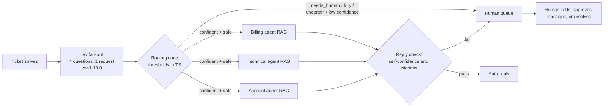

# Multi-Agent Support Desk

Incoming customer messages are triaged first by **Jev**, TypeSafe AI's fast decision model ("System 1"). Jev picks the department, measures frustration, and checks urgency and the need for a human — all four questions in a single fan-out request. Routing code then sends each ticket either to one of three specialist LLM agents ("System 2": Billing, Technical, Account) or to a **human escalation queue**. Each specialist drafts its reply from a small RAG knowledge base and cites the articles it used. Customers and accounts are simulated, so nothing is actually sent.

## Architecture



## Why a fast calibrated triage model comes first

- **Cost.** Jev costs $0.042 per million input tokens. A general LLM judging every ticket costs orders of magnitude more ($2.50/M input + $10/M output in this demo's comparison). The stats page shows the running totals side by side.
- **Latency.** Jev is a decision model, not a chat model — it returns calibrated answers in milliseconds, so every incoming ticket can be triaged on arrival without queuing for a slow LLM.
- **Routing thresholds stay in code.** The escalation policy (human threshold, fury score, minimum department confidence, urgency cutoff) is a pure TypeScript function with unit tests, persisted with every triage record. You can tune it with sliders and presets without touching prompts.
- **Human escalation is a first-class outcome.** Legal threats, refunds over $500, account deletion, hostile customers, or an "it's not working" message that doesn't fit any department are routed to the human queue with the exact rules that fired, instead of trusting an agent to wing it.

## Setup

1. Create a Supabase project and note the URL and anon key.
2. Set the edge function secrets (secrets stay server-side and never reach the browser):

   ```bash
   supabase secrets set TYPESAFE_API_KEY=... OPENAI_API_KEY=...
   ```

3. Apply migrations and deploy the functions, then run `seed-kb` once to embed the starter knowledge base.
4. Run the dev server:

   ```bash
   npm install
   npm run dev
   ```

## Environment variables

| Variable | Where | Purpose |
| --- | --- | --- |
| `TYPESAFE_API_KEY` | Edge function secret | Calls the TypeSafe System-1 API for Jev triage |
| `OPENAI_API_KEY` | Edge function secret | Embeddings + specialist agent chat completions |
| `OPENAI_BASE_URL` | Edge function secret (optional) | OpenAI-compatible base URL (default `https://api.openai.com/v1`) |
| `OPENAI_MODEL` | Edge function secret (optional) | Specialist agent model (default `gpt-4o-mini`) |
| `DAILY_CALL_LIMIT` | Edge function secret (optional) | Daily cap per counter (default `200`): paid TypeSafe/OpenAI calls and database writes are each capped per function |
| `VITE_SUPABASE_URL` | Frontend env | Supabase project URL |
| `VITE_SUPABASE_ANON_KEY` | Frontend env | Supabase anon key |

See `.env.example` for the frontend variables.

## Security model

- **The browser is read-only.** The anon key can `SELECT` the four app tables and nothing else. Every write (creating tickets, triage results, agent drafts, human approve/reassign/resolve, adding KB articles) goes through the `triage`, `agent-reply` and `seed-kb` Edge Functions, which use the service-role key from their environment, whitelist columns and bound payload sizes.
- **Functions require a JWT** (`verify_jwt = true`); the frontend calls them with `supabase.functions.invoke`, which sends the anon key.
- **Daily cap, fail closed.** Every paid upstream fetch (each TypeSafe call, each embedding, each chat completion, including retries) and every write is counted in `usage_counters` through the service-role-only `increment_usage_counter` function. Over the cap returns `429 { "error": "daily_limit" }`; if the counter can't be read the function returns `503` and makes no paid call.
- `usage_counters`, `increment_usage_counter` and `match_kb_articles` are not reachable with the anon key.

## Screenshots


## Design decisions

- **One fan-out, four questions.** All four Jev questions (department choice, frustration score, urgency, needs-human) are sent in a single request per ticket. That keeps triage latency and cost flat as the question list grows.
- **Questions are atomic and literal.** Each question asks exactly one thing, refers to state fields by their backticked names, and puts every threshold in application code — the model classifies, the code decides.
- **Jev triage always runs live**, even in "Mock agents" mode, so the demo always exercises the real System-1 path. Mock mode only swaps the specialist LLM replies for canned drafts that still cite real KB article ids.
- **Routing is a pure function.** `route(answers, policy)` takes Jev's answers plus a policy object and returns the route, priority, and fired rules. It is unit-tested (`scripts/test-routing.ts`) and the policy used for every decision is stored with the triage row. The `triage` Edge Function applies an identical copy server-side so the stored decision can't be forged by the browser; keep the two in sync.
- **Defense in depth on replies.** A specialist draft only auto-sends if the agent's self-confidence clears the threshold and it cited at least one KB article; otherwise it goes to the human queue with the reason.
- **Department colors are consistent everywhere** — Billing emerald, Technical sky, Account violet, Human amber — in the inbox, queue, architecture strip, and stats donut.
